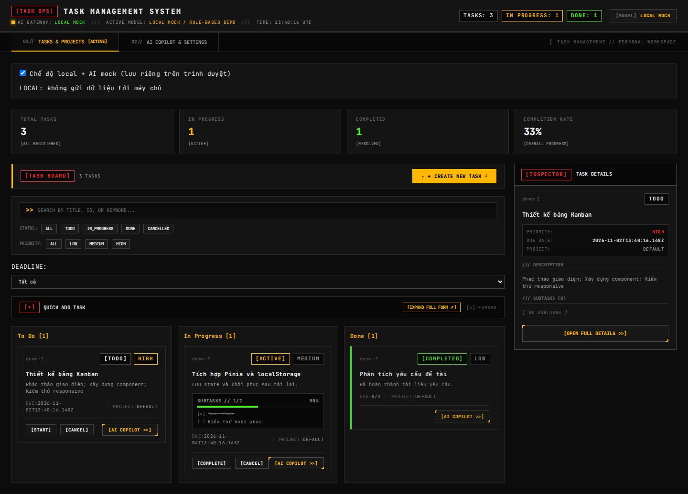
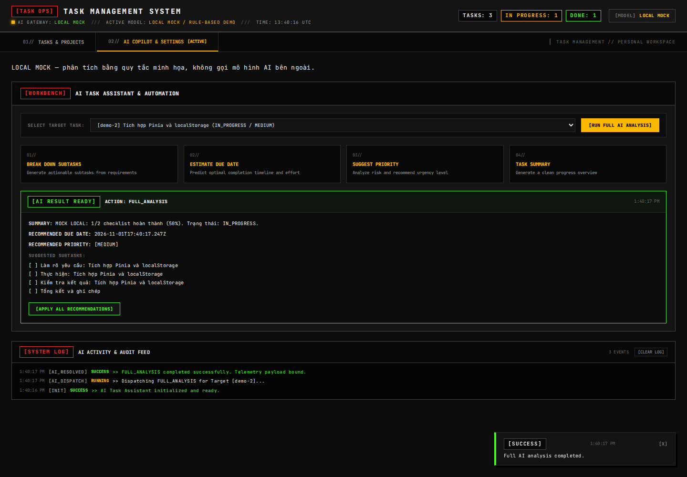
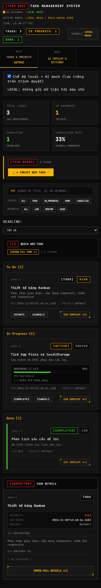

# Báo cáo hoàn thiện đề tài 4 — Quản lý Công việc & Dự án Cá nhân

**Tên đề tài:** Xây dựng ứng dụng quản trị công việc thông minh với Vue 3 Composition API và Pinia, tích hợp AI phân tích tiến độ và tự động tạo việc làm.

**Ngày thực hiện:** 01/11/2026.

Tài liệu này là báo cáo riêng về phiên bản hoàn thiện và các vị trí mã nguồn đã thay đổi. README ở thư mục gốc vẫn là tài liệu nền của backend. Các yêu cầu sản phẩm, giỏ hàng, màu sắc và tồn kho của ví dụ bán hàng không thuộc nghiệp vụ của đề tài này.

## Chương 1. Tổng quan và phân tích yêu cầu

### 1.1. Bài toán

Người dùng cá nhân cần tập hợp công việc theo dự án, theo dõi trạng thái, mức ưu tiên, deadline và tiến độ checklist. Một mô tả ban đầu thường chưa đủ cụ thể để thực hiện; trợ lý AI giúp đề xuất các bước nhỏ, ước lượng thời gian và tóm tắt tiến độ. Người dùng xem và chủ động áp dụng kết quả AI.

Ứng dụng gồm giao diện Vue, REST API Java và SQLite. Có thêm workspace local độc lập dùng localStorage để trình diễn hoặc làm việc khi không chạy backend.

### 1.2. Phạm vi chức năng

| Yêu cầu | Cách đáp ứng trong phiên bản hoàn thiện |
|---|---|
| Kanban To Do / In Progress / Done | Ba cột thực sự, số lượng thẻ theo từng cột; công việc hủy nằm trong vùng riêng |
| Tìm kiếm và lọc | Tìm theo tiêu đề, mô tả, ID; kết hợp trạng thái, ưu tiên và deadline bằng computed |
| State toàn cục bằng Pinia | Store `tasks` và `ai`, khởi tạo bằng `createPinia()` |
| Lưu dữ liệu khi tải lại | Lưu và khôi phục công việc/checklist qua localStorage có version |
| Công việc theo dự án | Giữ luồng chọn/tạo dự án trên server; task thiếu dự án được đưa vào Inbox |
| AI tạo checklist | Từ mô tả trong form hoặc phân rã công việc đã tạo |
| AI dự toán thời hạn | Hiển thị số giờ, deadline, mức tin cậy và giải thích; người dùng bấm áp dụng |
| AI phân tích tiến độ | Tóm tắt dựa trên trạng thái và số checklist hoàn thành |
| Kiểm tra chất lượng | ESLint, Vitest, JUnit, kiểm thử trình duyệt Playwright |
| CI/CD | CI backend/frontend/Docker; thêm workflow GitHub Pages cho frontend |

### 1.3. Quy tắc nghiệp vụ

- Trạng thái chuẩn: `TODO → IN_PROGRESS → DONE`. Có thể hủy từ `TODO` hoặc `IN_PROGRESS`.
- Công việc `DONE` và `CANCELLED` không được sửa checklist, deadline hoặc ưu tiên.
- Ba mức ưu tiên hợp lệ của backend: `LOW`, `MEDIUM`, `HIGH`.
- Checklist không rỗng, tối đa 200 ký tự/mục, không trùng tiêu đề không phân biệt hoa thường.
- Backend kiểm tra dữ liệu và quyết định kết quả lưu. Lỗi HTTP không được chuyển thành thông báo thành công giả trên giao diện.

## Chương 2. Cơ sở lý thuyết và công nghệ

### 2.1. Vue 3 và SPA

Giao diện là SPA: trình duyệt tải ứng dụng rồi Vue cập nhật các vùng thay đổi. `reactive` dùng Proxy để theo dõi việc đọc/ghi thuộc tính đối tượng; `ref` giữ giá trị phản ứng qua `.value` trong JavaScript. Khi dữ liệu phụ thuộc thay đổi, Vue cập nhật computed và giao diện liên quan.

Composition API được dùng trong `<script setup>`:

- `ref`: trạng thái mở modal, form, loading, task đang chọn trong AI panel.
- `reactive`: state của store và dữ liệu nhập biểu mẫu.
- `computed`: danh sách lọc, các cột Kanban, thống kê, tỷ lệ hoàn thành checklist.
- `watch`: lưu localStorage, theo dõi route động và làm sạch kết quả AI khi đổi task/modal.

### 2.2. Pinia

`webui/src/store/useTaskStore.js` chứa setup store có ID `tasks`; `useAiStore.js` chứa store `ai`.

| Thành phần | Ví dụ |
|---|---|
| State | `tasks`, `selectedTask`, `localMode`, `deadlineFilter`, `loading`, `error` |
| Getters bằng computed | `filteredTasks`, `kanbanColumns`, `taskStats` |
| Actions | `createTask`, `startTask`, `completeTask`, `toggleSubTask`, `addSubTasks`, `applyRecommendations`, `fetchTasks` |

Hàm export giữ giao diện gọi cũ của component nhưng dùng `storeToRefs` cho computed/state khi destructure. Vì vậy các component không làm mất tính phản ứng của getters.

### 2.3. Vue Router

Router dùng hash history, thích hợp cho hosting tĩnh. Route cha `/` có các route con:

- `#/tasks`: bảng công việc.
- `#/tasks/:taskId`: route động mở chi tiết công việc theo ID, có thể tải lại URL.
- `#/ai`: AI Copilot và cấu hình.

`App.vue` dùng RouterView và đồng bộ thanh điều hướng với URL. Route không tồn tại chuyển về bảng việc. ID không có trong workspace sẽ không mở modal.

### 2.4. Backend và AI

Backend Java 17 / Spring Boot giữ các lớp domain, application, adapter và infrastructure. SQLite lưu dữ liệu thật; các adapter AI tương thích OpenAI, Anthropic và Gemini đã có từ phiên bản trước.

Phân biệt ba cách sử dụng:

1. **Server + AI bên ngoài:** backend gọi nhà cung cấp theo cấu hình và API key.
2. **Simulated adapter ở backend:** có sẵn trong mã nguồn và được kiểm thử, nhưng API runtime hiện không tự bật adapter này khi thiếu key. Khi không có key, chọn workspace local để dùng mock.
3. **Local + AI mock:** JavaScript dùng quy tắc xác định, không gọi mô hình bên ngoài. Kết quả được ghi `MOCK LOCAL`, không đại diện cho năng lực của mô hình thật.

API key của nhà cung cấp AI không được lưu vào localStorage công việc. Trường key bị che từ server không được lấy làm key thật để gửi ngược lại.

### 2.5. CI/CD

GitHub Actions thực hiện các bước kiểm tra khi push/PR vào `main`. Build thành công là điều kiện tạo artifact; workflow Pages chỉ deploy khi job lint/test/build frontend thành công. Việc đẩy Docker image lên GHCR vẫn được giữ riêng.

## Chương 3. Thiết kế, cài đặt và chi tiết các thay đổi

### 3.1. Cây component

```text
App
├── TacticalHeader
├── TacticalNav
├── RouterView
│   ├── TaskOpsView
│   │   ├── TaskCard × N trong ba cột Kanban
│   │   ├── CreateTaskModal
│   │   └── TaskDetailModal
│   └── AiCopilotView
│       ├── AiPromptEditor
│       └── AiTelemetryLog
└── TelemetryNotifier
```

`v-for` tạo các cột và thẻ; `v-if` điều khiển trạng thái rỗng, thao tác hợp lệ, modal và kết quả AI. `@click` chọn/chuyển trạng thái công việc; `@mouseover` cập nhật vùng xem nhanh. Kanban chuyển thẻ bằng nút Start/Complete, chưa có kéo thả.

### 3.2. Các lỗi cũ và cách sửa

| Trước khi sửa | Sau khi sửa | Tệp chính |
|---|---|---|
| Composable `reactive` dùng chung, chưa có Pinia | Hai setup store Pinia, đăng ký plugin ở entry point | `main.js`, `store/useTaskStore.js`, `store/useAiStore.js` |
| Danh sách dạng lưới | Ba cột Kanban và vùng công việc hủy | `components/tasks/TaskOpsView.vue` |
| Frontend dùng `COMPLETED`, backend dùng `DONE` | Frontend thống nhất `DONE`, dữ liệu cache cũ được chuyển đổi | Store, TaskCard, TaskDetailModal |
| Cho chọn `CRITICAL` nhưng backend không có enum tương ứng | Form và bộ lọc chỉ cung cấp ba mức hợp lệ | TaskOpsView, CreateTaskModal |
| Không có lọc deadline | Tất cả, quá hạn, hôm nay, 7 ngày tới, chưa đặt hạn | Task store, TaskOpsView |
| Danh sách server rỗng vẫn giữ dữ liệu mẫu | `[]` từ server được chấp nhận là danh sách thật | `fetchTasks` |
| Lỗi API tạo/chuyển trạng thái được giả lập thành công | Server mode giữ nguyên lỗi; local mode phải chọn rõ ràng | Task store |
| Checklist khi tạo chỉ ghép vào state frontend | Request tạo task nhận `subTasks`; domain kiểm tra trước khi lưu cùng task | TaskCreateRequest, TaskApiController, TaskControl |
| Tích checklist chỉ đổi bộ nhớ frontend | API PATCH cập nhật trạng thái và lưu qua repository | TaskApiController, TaskControl, Task, SubTask |
| Áp dụng AI deadline/priority chỉ đổi giao diện | Gọi API áp dụng, tải kết quả task rồi cập nhật state | Task store, TaskDetailModal, AiCopilotView |
| Áp dụng kết quả AI sang task đang chọn khác | AI panel dùng `taskId` gắn với kết quả đã phân tích | AiCopilotView |
| Xác minh key chỉ đọc danh sách model, chưa gắn key/model vào provider chạy thật | Lưu cấu hình provider sau xác minh thành công, chọn model không xóa key backend; không báo thành công giả khi đổi provider thất bại | `store/useAiStore.js`, AiPromptEditor |
| UI đọc sai trường DTO AI | Dùng `effectivePriority`, `confidence`, `explanation` theo backend | AiCopilotView, TaskDetailModal |
| Chưa có khôi phục công việc local | Watch sâu, lưu JSON có version, xử lý lỗi đọc/ghi storage | Task store |
| Chỉ chuyển tab nội bộ | Route cha/con và route động theo task ID | `router/index.js`, App, TaskOpsView |

### 3.3. Lưu trữ và chính sách đồng bộ

Khóa chính: `task-management:v1`, chứa `{ version: 1, tasks, localMode }`. Hai snapshot workspace bổ sung:

- `task-management:workspace:local`
- `task-management:workspace:server`

Trong local mode, thao tác được ghi vào localStorage, tải lại vẫn giữ checklist và trạng thái. Trong server mode, API/SQLite là nguồn dữ liệu chính; localStorage là cache để xem lại khi server chưa truy cập được. Khi đổi workspace, ứng dụng lưu workspace cũ rồi khôi phục workspace mới. Không tự động đẩy task local lên server và không tự hợp nhất xung đột đa thiết bị.

Dữ liệu mẫu dựng sẵn đã được bỏ khỏi task store. Bảng trống khi chưa có task là trạng thái hợp lệ. Nếu localStorage bị chặn/hết dung lượng hoặc JSON không đọc được, giao diện có thông báo lỗi. Không coi localStorage là bản sao lưu lâu dài.

### 3.4. Lọc deadline và thống kê

`filteredTasks` kết hợp toàn bộ bộ lọc. `OVERDUE` chỉ lấy công việc đang hoạt động có deadline trước hiện tại; `TODAY` dùng ngày địa phương của trình duyệt; `WEEK` lấy deadline từ hiện tại đến 7 ngày sau; `NONE` lấy task không có hạn.

Đồng hồ phản ứng cập nhật mỗi phút để bộ lọc quá hạn không đứng yên khi người dùng để bảng mở lâu. Tỷ lệ hoàn thành tổng thể bằng số task `DONE` chia tổng task, bao gồm cả task hủy trong mẫu số. Tỷ lệ checklist tính riêng từ số mục đã hoàn thành.

### 3.5. API checklist được bổ sung

Tạo task kèm checklist:

```http
POST /api/tasks
Content-Type: application/json

{
  "title": "Viết báo cáo",
  "description": "Soạn nội dung và kiểm tra minh chứng",
  "priority": "MEDIUM",
  "subTasks": ["Soạn bản nháp", "Rà soát nội dung"]
}
```

`subTasks` là tùy chọn. Backend thêm toàn bộ checklist vào aggregate trước khi lưu, do đó danh sách trùng/không hợp lệ không tạo ra task dở dang.

Cập nhật checklist:

```http
PATCH /api/tasks/{taskId}/subtasks/{subTaskId}
Content-Type: application/json

{"completed": true}
```

Gửi `false` để bỏ tích. Request thiếu `completed` trả 400; task/subtask không hợp lệ và task đã kết thúc được xử lý theo quy tắc domain.

### 3.6. Luồng AI

1. Nhập tiêu đề và mô tả; có thể xuống dòng từng ý.
2. Dùng chức năng tạo checklist trong form hoặc mở chi tiết task để phân rã.
3. Xem danh sách đề xuất; bấm áp dụng để lưu.
4. Dùng Estimate Due Date; xem số giờ, deadline và giải thích rồi áp dụng.
5. Tích checklist, dùng Summarize/Full Analysis để đọc tiến độ.

AI mock local tách các dòng mô tả hoặc tạo các bước mẫu; ước lượng 4 giờ cho mỗi mục còn lại. Đây là quy tắc phục vụ demo, cần người dùng kiểm tra trước khi áp dụng. Chức năng full analysis áp dụng nhiều API liên tiếp, không phải một transaction chung cho tất cả đề xuất.

## Chương 4. Hướng dẫn chạy và CI/CD

### 4.1. Chạy local không cần backend

Yêu cầu Node.js 22 LTS hoặc bản tương thích mới hơn.

```bash
cd webui
npm ci
npm run dev
```

Mở `http://localhost:5173`, bật **Chế độ local + AI mock** ở đầu bảng việc. Tạo công việc và thử AI. Dữ liệu gắn với trình duyệt và origin đang sử dụng. Đổi cổng/domain sẽ sử dụng vùng localStorage khác.

### 4.2. Chạy cùng backend

Terminal thứ nhất tại thư mục gốc:

```bash
mvn spring-boot:run
```

Terminal thứ hai:

```bash
cd webui
npm ci
npm run dev
```

Cấu hình thực tế của backend mặc định cổng **8081**, trùng proxy Vite. Docker Compose đặt cổng **8080** bằng biến môi trường. Nếu chạy backend ở cổng khác, đặt `API_PROXY_TARGET`, ví dụ `API_PROXY_TARGET=http://localhost:8080 npm run dev`.

Tắt local mode để dùng server. Nếu backend bật `API_KEY`, frontend hỗ trợ đọc key xác thực ứng dụng từ sessionStorage `task-api-key`. Đây là key truy cập ứng dụng, khác API key nhà cung cấp AI.

### 4.3. Các lệnh kiểm tra

```bash
# Tại thư mục gốc
mvn test

# Tại webui
npm run lint
npm test
npm run build
npx playwright install --with-deps chromium
npm run test:e2e
```

Vitest chỉ thu thập test trong `src`; Playwright chạy test riêng trong `e2e`. Các test API dùng SQLite tạm, không sửa database người dùng.

### 4.4. CI và GitHub Pages

- `.github/workflows/ci-cd.yml`: giữ Maven verify, Docker smoke test, GHCR; bổ sung lint, unit test và kiểm thử Chromium trước build frontend.
- `.github/workflows/pages.yml`: lint → unit test → build với base path theo tên repository → upload artifact → deploy Pages.
- `vite.config.js`: hỗ trợ `VITE_BASE_PATH`; hash router giúp tải lại route trên hosting tĩnh.

Để bật triển khai, chủ repository cần chọn **Settings → Pages → Source: GitHub Actions** rồi push thay đổi lên `main` hoặc chạy workflow thủ công. Workflow đã được viết nhưng chưa được chạy trên GitHub trong lần làm việc này; chưa có link live được xác minh.

GitHub Pages chỉ chạy frontend tĩnh. Bật local mode để demo đầy đủ Kanban/checklist/mock AI. Muốn dùng SQLite và AI thật trên bản public phải triển khai backend riêng và cấu hình reverse proxy/API phù hợp. Vite proxy chỉ có tác dụng khi chạy dev server.

## Chương 5. Kiểm chứng, đánh giá và hướng phát triển

### 5.1. Kết quả kiểm tra

| Kiểm tra | Kết quả |
|---|---|
| `mvn -o -B -ntp test` | **161 tests passed**, 0 failure, 0 error |
| `npm run lint` | Thành công |
| `npm test` | **15 tests passed** |
| `npm run build` | Build production thành công |
| Playwright / Chromium | **2 kịch bản passed**, gồm reload/checklist/AI/deadline, Kanban và ảnh mobile |
| `git diff --check` | Không có lỗi khoảng trắng |

Đã kiểm tra API tạo task kèm checklist và PATCH checklist bằng MockMvc với SQLite tạm; mở lại repository xác nhận mục đã tích được lưu thật. Kiểm thử trình duyệt sử dụng workspace local và AI mock; không gọi nhà cung cấp AI trả phí.

Ảnh chụp dùng dữ liệu minh họa tạo riêng cho kiểm thử trình duyệt, không chèn dữ liệu mẫu vào ứng dụng khi người dùng chạy bình thường.

**Kanban desktop:**



**AI phân tích tiến độ checklist:**



**Kanban trên điện thoại:**



Các tình huống được kiểm tra tự động gồm lưu/khôi phục state, chuyển trạng thái hợp lệ, từ chối sửa task đã kết thúc, lọc deadline, tách workspace, server rỗng, lỗi API không tạo thành công giả, checklist qua API và tiến độ AI mock.

### 5.2. Kịch bản trình diễn

1. Bật local mode và tạo ba task ở ba trạng thái.
2. Lọc theo ưu tiên, từ khóa và deadline.
3. Mở một task; tạo checklist bằng AI, tích một số mục.
4. Dùng tóm tắt để xem phần trăm tiến độ và ước tính deadline.
5. Áp dụng đề xuất, tải lại trang để chứng minh dữ liệu còn nguyên.
6. Mở trực tiếp route task ID để chứng minh dynamic routing.
7. Khi chạy backend, tạo task kèm checklist rồi tải lại để kiểm chứng SQLite.

### 5.3. Giới hạn và hướng phát triển

- Kanban hiện chuyển bằng nút; có thể bổ sung kéo thả và thao tác bàn phím tương ứng.
- Local mode chưa có danh mục dự án riêng; tạo/quản lý dự án hiện cần server.
- Không tự hòa giải task offline với server, không đồng bộ nhiều thiết bị, không có đăng nhập nhiều tài khoản.
- Tóm tắt AI lưu trong cache trình duyệt; backend hiện không có cột riêng để lưu bản tóm tắt.
- Có thể bổ sung export/import, sao lưu, lịch/nhắc hạn, biểu đồ tiến độ và kiểm tra xung đột phiên bản.
- AI thật phụ thuộc nhà cung cấp và khóa cấu hình; chưa kiểm chứng bằng API key trả phí trong lần hoàn thiện này.

### 5.4. Vị trí thay đổi và minh chứng

Các tệp frontend nằm trong `webui/src`; backend trong `dependencies/src/main/java/com/taskmanagement`. Test bổ sung nằm ở `webui/src/store/useTaskStore.test.js`, `webui/src/store/useAiStore.test.js`, `webui/e2e/kanban.spec.js`, `TaskControlTest.java` và `TaskChecklistApiTest.java`.

Các dependency frontend được cập nhật qua lockfile. Lần audit trong quá trình cài công cụ còn ghi nhận advisory mức moderate ở nhóm công cụ phát triển; không coi build/test thành công là xác nhận toàn bộ dependency đã hết advisory.

Không thực hiện commit, push hoặc triển khai công khai trong phiên làm việc này. Link GitHub/live cần lấy từ repository và kết quả workflow thực tế khi nộp báo cáo.

## Bổ sung: triển khai trên Vercel

Cấu hình mới ở thư mục gốc:

- `vercel.json`: cài dependency trong `webui`, build Vue và phục vụ `webui/dist`.
- `api/[...path].mjs`: Vercel Function chuyển tiếp `/api/**` tới Java backend qua biến `TASK_API_ORIGIN`. Giữ nguyên mã lỗi API, không cache dữ liệu và không chuyển tiếp cookie của frontend.
- `.vercelignore`: không upload database, mã backend Java, báo cáo, thư mục công cụ và tệp môi trường riêng tư.
- `.env.example`: mẫu cấu hình, không chứa key thật. `.env.ai-test.local` có thể dùng để cung cấp cấu hình thử nghiệm riêng; tệp môi trường thật bị loại khỏi Git và upload.

Trong Vercel, chọn **Root Directory là thư mục gốc repository**, không chọn `webui`, để function `/api` được triển khai cùng frontend. Đặt `TASK_API_ORIGIN` bằng URL HTTPS của Java backend, rồi redeploy sau khi thay đổi biến môi trường. Frontend vẫn dùng hash router, không cần rewrite mọi URL về index.html.

Java backend cần một host hỗ trợ Java/Docker và volume bền vững cho SQLite. Vercel không chạy trực tiếp tiến trình Spring Boot/SQLite của dự án này. Nếu chưa có backend, endpoint proxy trả 503 với thông báo cấu hình; workspace local vẫn dùng được.

Trạng thái ở thời điểm chuẩn bị: đã viết cấu hình, kiểm thử proxy và build thành công. Hai lần đăng nhập Vercel CLI bị ngắt với `fetch failed`; kiểm tra HTTPS trực tiếp tới Vercel API trả lỗi kết nối `ECONNRESET`. Chưa có deployment URL được xác minh và chưa nhận cấu hình/key AI thật. Không dùng trạng thái này làm minh chứng deploy thành công.
